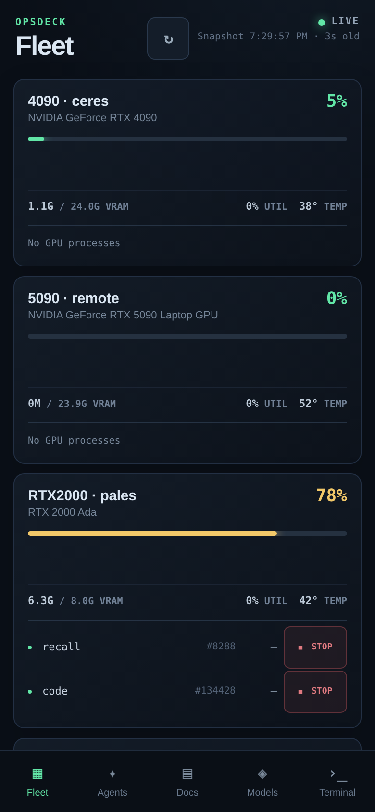
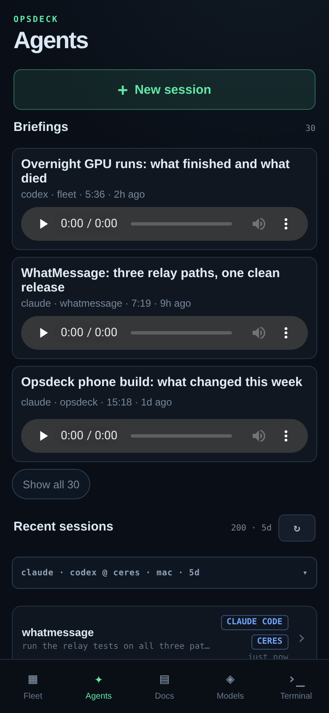
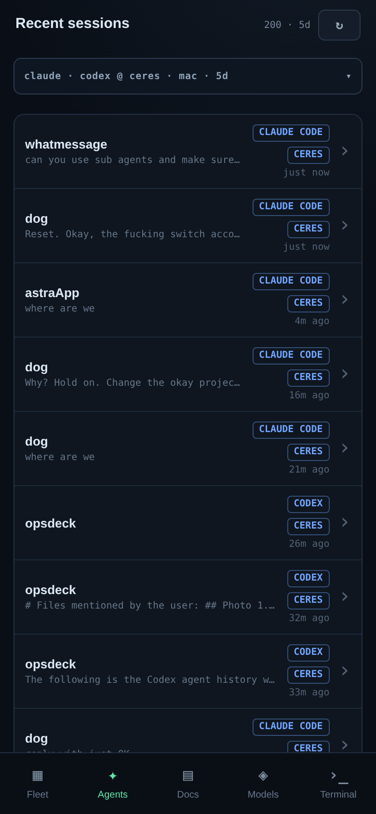
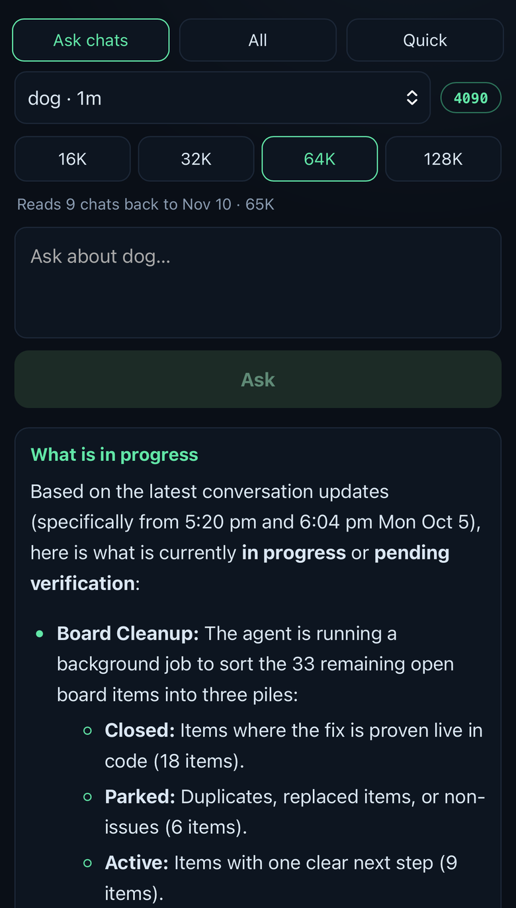
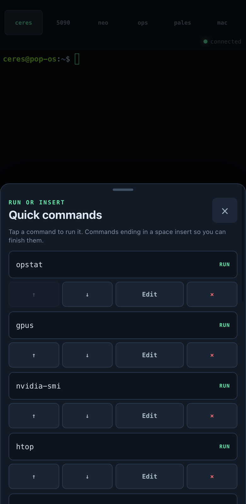
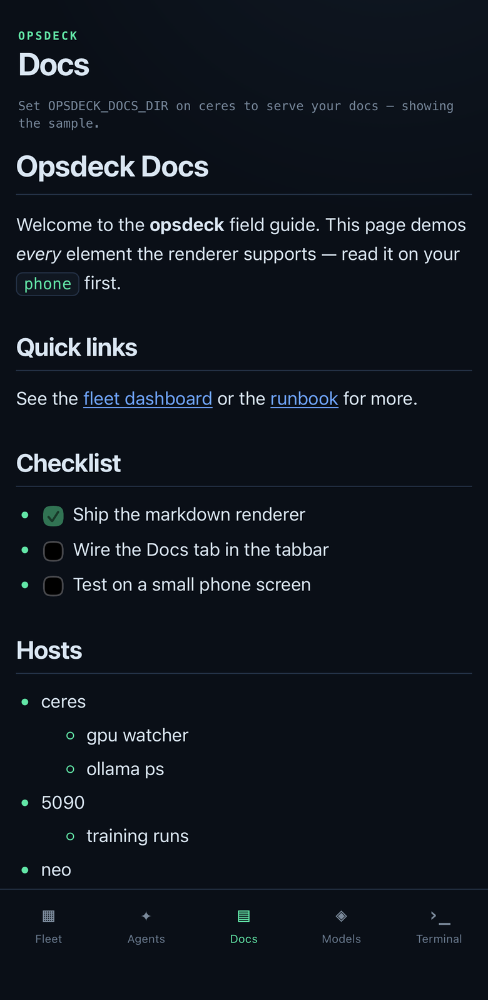

# Opsdeck

Opsdeck is the phone dashboard I built to run my own workstation, remote GPU boxes, coding agents, notes and local models. This is a cleaned copy of the source I actually use. My addresses, credentials, session data and machine-specific scripts are stripped out, and each of those has a config hook so you can plug in your own. It's MIT licensed, so take what you want. It's my personal tool, not a supported product.

## Preview

These are from my own install. A few labels are swapped out where they showed private work.

     

## Why I built it

I run about ten machines and more AI agents than I can count. Every agent lives in its own company's app. ChatGPT's app isn't going to run Claude Code, Claude's isn't going to run Codex, and some tools don't have an app at all, just another terminal window. I wanted one place on my phone for all of it.

- **Fleet:** agents kept running my machines out of memory. I'd be out in Asheville, look at my phone, and some agent had locked me out of my own computer. Now I can see which box is drowning and hit Stop on whatever is hogging it.
- **Agents:** start or check any agent on any machine, no matter which company makes it.
- **Ask chats:** a local model reads a project's recent agent sessions and answers questions about them. Agents use it too, so "where were we" doesn't burn paid tokens.
- **Briefings:** agents read their summaries to me out loud. I kept reading agent output in the car, my girlfriend hated it, so now I listen instead.
- **Terminal:** Termius annoyed me, so I wrote my own, with buttons for the commands I type fifty times a day.
- **Docs:** reading Markdown in every agent app sucks, Codex and Claude Code included. This one renders it properly on a phone.

## What is in this copy

- Fleet shows the server's one-minute load, memory, and home-disk usage, plus the reachability of up to eight optional SSH aliases. NVIDIA GPU cards and compute processes appear when `nvidia-smi` is installed. A confirmed Stop action can signal a process listed in a fresh GPU snapshot on the server or a configured SSH host. The same rich Fleet layout as my app can be fed by your own `OPSDECK_STATUS_FILE`: GPU cards, hosts, agent session summaries, and loaded models.
- Docs lists and reads Markdown from an optional, dedicated `OPSDECK_DOCS_DIR` on the server.
- Terminal opens a shell on the server or an SSH alias that you configured.
- Models has the GPU-box picker, status and holder details, model choice, text/photo prompts, thinking option where supported, run history, unload, and worker start/stop controls. Configure Ollama-compatible endpoint(s) through `OPSDECK_MODELS` and/or your own box adapters through `OPSDECK_MODEL_ADAPTERS_FILE`. A configured adapter can use the same private worker tools as my installation without publishing those tools or machine addresses. With no box configured the tab explains setup.
- Ask chats (optional) answers questions over your own compatible external
  Ask service via a server-side relay (`/api/ask/*`); the external service
  is not included here. Unconfigured tabs show setup cards; Quick Run keeps
  working. An optional `OPSDECK_ASK_CONSOLE_URL` embeds your own console web
  UI as the tab's full-console view, with an external-open fallback.
- Agents launches agent CLI sessions on the server or an SSH alias, with
  recent-session history, transcript/chat view, project picker, skill catalog,
  and model/effort choices. It is configured entirely by server-side
  environment variables (`OPSDECK_AGENTS`, `OPSDECK_AGENT_COMMANDS` with
  optional `agent@machine=` per-host overrides, `OPSDECK_AGENT_MODELS`,
  `OPSDECK_PROJECT_ROOTS`, `OPSDECK_AGENT_SESSIONS_DIR`, `OPSDECK_SKILLS_DIR`).
  Command execution uses the server owner's privileges: the phone sends only
  ids, names, and prompt text, and commands run only when their prerequisites
  are configured, otherwise the tab reports setup state instead of dead
  controls. Supported CLI prerequisites are the operators' own installs of the
  `claude`, `codex`, `kimi`, and `qwen` CLIs at configured absolute paths;
  `muse` is supported for new runs. `glm` requires an operator-provided
  adapter executable that accepts a prompt as its sole positional argument.
  An optional `OPSDECK_BRIEFINGS_DIR` adds the spoken Briefings panel.
- The five main phone tabs and the native Capacitor/Xcode iPhone shell source are here. The shell uses example origins and bundle ID until you set your own; see [IOS_SETUP.md](IOS_SETUP.md). My machine-specific telemetry collectors, model-worker adapters, credentials, and runtime data are not included.

## Build and configuration reference

It requires Python 3.11+, Node.js 20.19+ or 22.12+, npm, and an SSH client for remote hosts.

```bash
python3 -m venv server/.venv
server/.venv/bin/pip install -r server/requirements.txt
npm --prefix web ci
npm --prefix web run build
export OPSDECK_TOKEN="$(python3 -c 'import secrets; print(secrets.token_urlsafe(32))')"
export OPSDECK_SSH_HOSTS=""  # optional comma-separated SSH aliases
export OPSDECK_DOCS_DIR=""   # optional dedicated Markdown directory
export OPSDECK_MODELS=""    # optional "label=http://host:11434,..." Ollama endpoints
export OPSDECK_ASK_URL=""   # optional Ask service base URL (see below)
server/.venv/bin/uvicorn server.app:app --host 127.0.0.1 --port 8091 --no-access-log
```

Open `http://127.0.0.1:8091` and enter the token. Keep the token outside this repository. See [PHONE_SETUP.md](PHONE_SETUP.md) for a private tailnet phone route. Do not expose the terminal server directly to the public Internet.

## Agent setup

Install an agent CLI on the server, then enable only the agents and project roots you use. For example, after installing Codex at the path shown on your own machine:

```bash
export OPSDECK_AGENTS="codex"
export OPSDECK_AGENT_COMMANDS="codex=/absolute/path/to/codex"
export OPSDECK_PROJECT_ROOTS="/absolute/path/to/projects"
```

Each project appears as a folder below that root. Add SSH aliases to `OPSDECK_SSH_HOSTS` and use `agent@alias=/absolute/path` and `alias=/absolute/path` entries for machines with different CLI paths, project roots, or transcript stores. The optional `OPSDECK_AGENT_SESSIONS_DIR` points to JSONL sessions in a flat folder or `<agent>/*.jsonl` layout; without it, recent history shows only runs launched from this Opsdeck copy. `OPSDECK_AGENT_MODELS` supplies optional picker choices. Briefings require audio files plus JSON sidecars in `OPSDECK_BRIEFINGS_DIR`. See [`.env.example`](.env.example) for the exact syntax. Agent runs execute as the server owner, and the bearer token grants access to their controls.

## Development

Run `npm --prefix web run dev` for the frontend. The backend reads `OPSDECK_TOKEN`, optional `OPSDECK_SSH_HOSTS`, optional `OPSDECK_DOCS_DIR`, and optional `OPSDECK_MODELS` from its environment. `OPSDECK_MODELS` is a comma-separated list of `label=url` entries pointing at your own Ollama-compatible servers (any host running `ollama serve`); endpoint URLs come only from this server-side setting, never from phone input. Model runs are polled jobs with a bounded prompt (8000 chars), bounded responses, at most three concurrent jobs (extra submits get HTTP 429), and per-request timeouts; Ollama requests are non-streaming; the run store under `~/.opsdeck-community/model-runs` is owner-only (0700/0600) with atomic result writes. Photos are resized on-device to at most 1024px JPEG before upload; the server accepts PNG or JPEG up to 4 MB, forwards them as the Ollama `images` array (vision-model support depends on the model), and never writes image bytes to disk. Unload sends `prompt: ""` with `keep_alive: 0` for that model. SSH aliases must be resolvable by the server's SSH configuration; Opsdeck does not configure SSH or add credentials. Use a dedicated Docs directory because anyone with the Opsdeck token can read its Markdown files.

## Rich Fleet data and model boxes

Set `OPSDECK_STATUS_FILE` to a JSON file written by your own telemetry collector. The file can supply `gpus`, `hosts`, `agents`, `ollama`, and `local_metrics` using the same field names shown in [examples/fleet-status.json](examples/fleet-status.json). Without it, Fleet collects basic server metrics, local NVIDIA GPUs, and configured SSH reachability. The example file is synthetic; set `OPSDECK_STATUS_FILE` to its path to preview the fuller Fleet layout. A sample snapshot never stops a real process.

`OPSDECK_MODEL_ADAPTERS_FILE` points to a private JSON configuration outside the repository. It adds model boxes that use your own worker scripts in addition to Ollama endpoints. Each box has an `id`, `label`, and absolute `command` argv; optional booleans `image`, `think`, `unload`, `worker_start`, and `worker_stop` control which buttons appear. For example:

```json
{"boxes":[{"id":"lab","label":"Lab GPU","command":["/absolute/path/to/model-adapter"],"image":true,"think":true,"unload":true,"worker_start":true,"worker_stop":true}]}
```

Opsdeck appends one fixed action (`status`, `run`, `unload`, `worker-start`, or `worker-stop`), sends a JSON object on stdin, and expects one JSON object on stdout. `status` returns `{"ok":true,"models":["model-name"],"holder":"","gpu":{"temp_c":48,"mem_used_mb":9200,"mem_total_mb":24576,"util_pct":31}}` (every `gpu` field is optional); `run` receives `model`, `prompt`, `max_tokens`, `think`, and optional `image_base64`, then returns `{"answer":"..."}` or `{"state":"refused","held_by":"..."}`. Lifecycle actions return `{"ok":true}`. The private adapter can call SSH, a local API, or a worker scheduler; the phone cannot choose its executable or endpoint. Adapter jobs are bounded and polled like Ollama jobs.

## Ask chats (optional external service)

The external Ask service is **not** included in this repository: it is a
separate program you operate. Opsdeck only relays the phone's Ask chats
screen to it. Configure the server side and restart:

```bash
export OPSDECK_ASK_URL="http://127.0.0.1:8756"
export OPSDECK_ASK_BOX="local"            # id your service uses for readiness
export OPSDECK_ASK_TOKEN=""               # optional upstream bearer token
export OPSDECK_ASK_CONSOLE_URL=""         # optional console web UI to embed
```

Rules the relay enforces:

- Endpoint URLs come only from `OPSDECK_ASK_URL` / `OPSDECK_ASK_CONSOLE_URL`;
  the phone never sends an upstream URL, and any client-supplied box id is
  ignored in favor of `OPSDECK_ASK_BOX` (default `local`).
- Only `http://`/`https://` URLs without embedded credentials are accepted.
  Upstream redirects are refused rather than followed.
- Requests are bounded (64 KB in, 2 MB stored responses) with per-endpoint
  timeouts; upstream failures surface as 502 without the upstream address.
  An upstream 401/403 never becomes an Opsdeck 401, so a service credential
  problem cannot log the phone out.
- All `/api/ask/*` routes require the Opsdeck bearer token.

Required service API (all JSON):

- `GET /api/chats/projects` returns `{"projects": [{"name", "lastActive"}]}`.
- `GET /api/local/{box}/status` returns a readiness object (truthy `current`,
  `loadedModel`, or `ok` means ready).
- `POST /api/chats/fit` takes `{"mode": "chats", "project", "size", "box"}`.
- `POST /api/chats/ask` takes `{"box", "thread", "question", "maxTokens",
  ...}` plus the fit params, and returns `{"job": "<id>"}`.
- `GET /api/chats/job?id=<id>` returns `{"status": "done"|"error"|...,
  "result": {"text", ...}}`; the phone polls until `done` or `error`.

With `OPSDECK_ASK_URL` unset, the relay answers 503 and the Ask tab shows a
setup card while Quick Run keeps working. With `OPSDECK_ASK_CONSOLE_URL`
unset, the Console tab shows its own setup card; when set, the tab embeds
that address (which you must trust) and offers an external-open fallback link
for consoles that refuse embedding.

The terminal WebSocket requires a same-origin browser connection and receives the token in its first message. It limits pending authentication handshakes and connection attempts per address visible to the backend. If an HTTPS reverse proxy changes the scheme or host seen by the backend, set `OPSDECK_ALLOWED_ORIGINS` to the exact external origin, such as `https://opsdeck.example.com`. Run the integration tests with `server/.venv/bin/python -m unittest discover -s tests -v`.

GitHub Actions runs the backend integration tests and frontend build on each push and pull request. The local server-health card reads Linux `/proc/meminfo` when available; load and disk values use the Python standard library.

See [SECURITY.md](SECURITY.md) for the trust model and private reporting route.
